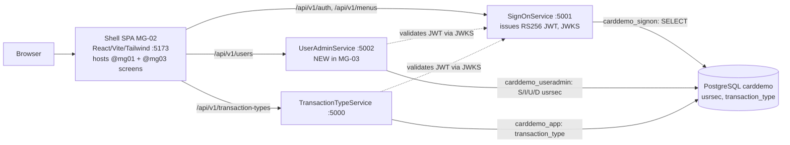

# MG-03 — Architecture (User Security Administration)

| Legacy | Target |
|---|---|
| CU00 COUSR00C STARTBR/READNEXT/READPREV | `GET /api/v1/users` keyset paging; User List screen |
| CU01 COUSR01C WRITE | `POST /api/v1/users`; Add User screen |
| CU02 COUSR02C READ UPDATE/REWRITE | `GET` + `PUT /api/v1/users/{id}` with `If-Match`; Update User screen |
| CU03 COUSR03C READ UPDATE/DELETE | `GET` + `DELETE /api/v1/users/{id}` with `If-Match`; Delete User screen |
| COMMAREA CDEMO-CU0x-INFO (page keys, selection) | Client state: page keys in the component and the selected ID in the route |
| CICS file security on USRSEC | Admin role and scope in the JWT; least-privilege database login |

Each service owns its own database login. Write access to `usrsec` is isolated in UserAdminService, and SignOnService remains read-only. This is a microservice split by business capability; the services share one database with table-level grants.
